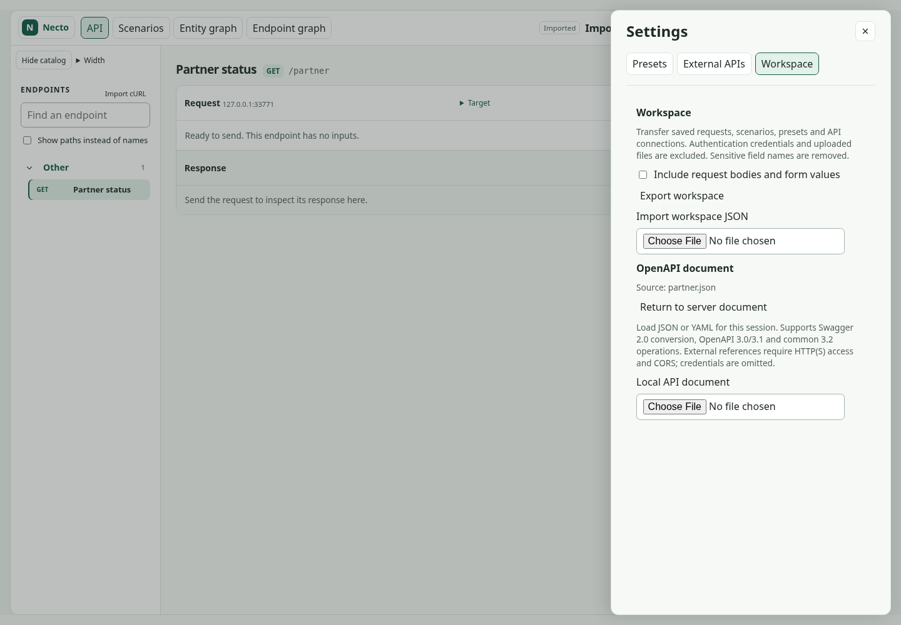

# F01 — Preserve the active document during authorization

Apply and Retry now retain an imported OpenAPI document instead of silently reloading the server catalog. The source is explicit in Workspace and a compact Imported label reuses the existing identity header. Return to server document is a separate action. Import cancels stale catalog loads; server-return failures do not discard the imported spec.

Validation: production build, 14 authentication tests and browser flow verifying import → Apply → Retry retains Partner status, followed by explicit return to the server catalog.

