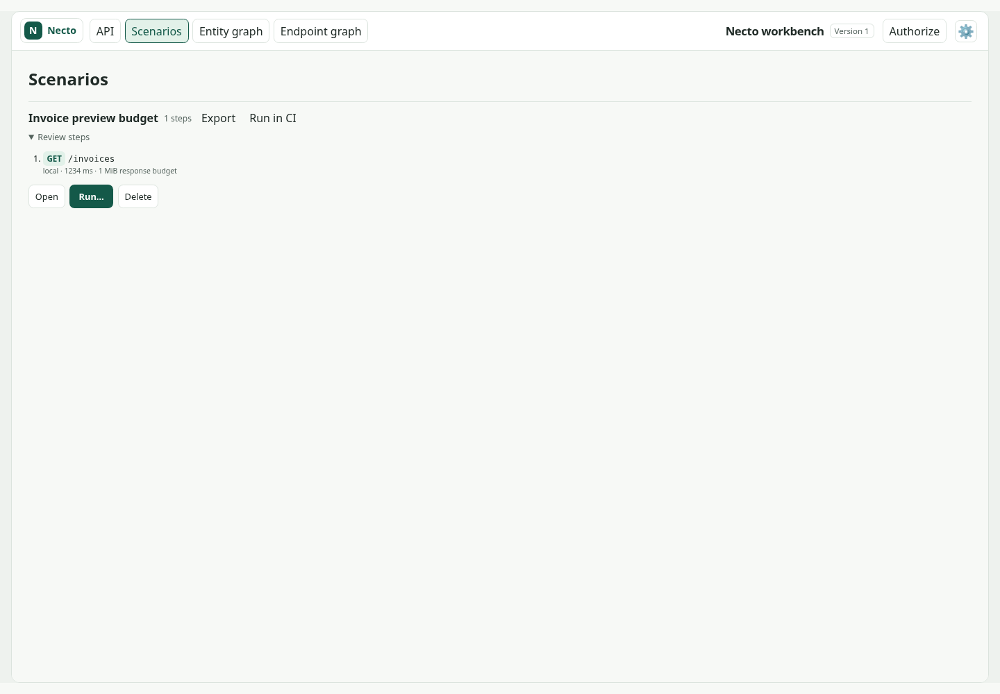

# F02 — Preserve execution options across replay

One validated execution-options snapshot now carries timeout and the response budget through scenarios, history, saved requests and workspace/CI exports. Old records default to 30 s / 32 MiB. UI execution and the CLI use the same policy, including the saved reception budget. Scenario Review steps shows both settings on demand.

CI exports use bundle v2, which older runners reject. Clean builds pin the runner to the actual source commit; modified/source-archive builds instruct users to use their matching checkout rather than an older release tag. New runners still accept v1 bundles.

Validation: 151 UI/module tests, production build, round trips for 1/64 MiB, invalid import values and a CI test that cancels an oversized response. Browser checks confirm scenario opening and downloaded CI bundles retain 1 MiB and 1234 ms.

