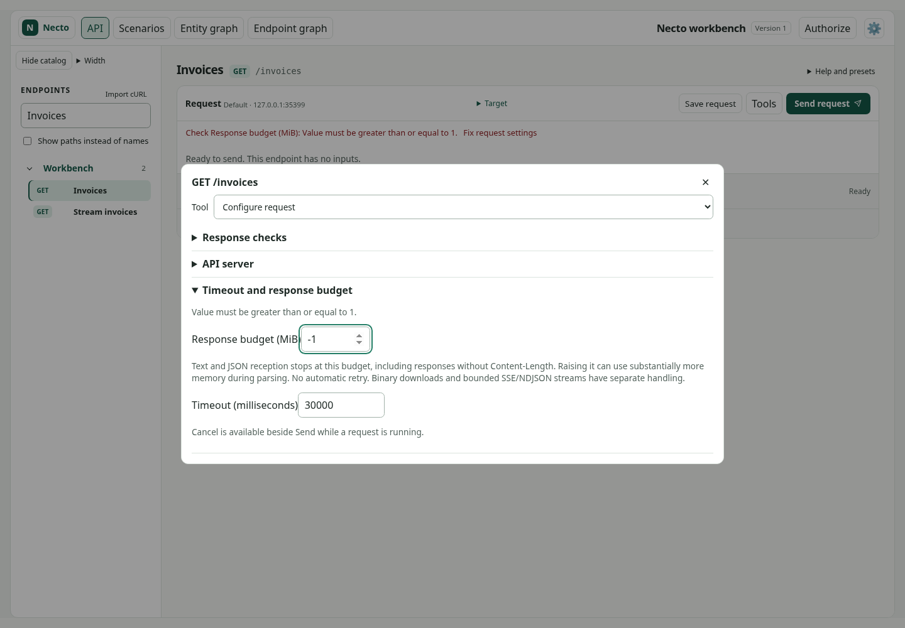

# F03 — Explain invalid settings instead of silently blocking Send

A native-invalid setting inside closed Tools now opens the relevant configuration group, focuses the field and shows its validation message. The request pane also offers Fix request settings while the error remains. Budget and timeout require whole numbers; correction clears feedback. Ordinary request-input validation keeps its native behavior.

Validation: production build and browser tests for invalid budget and timeout, zero HTTP calls before correction, focused error recovery and exactly one successful request after fixing both fields.

