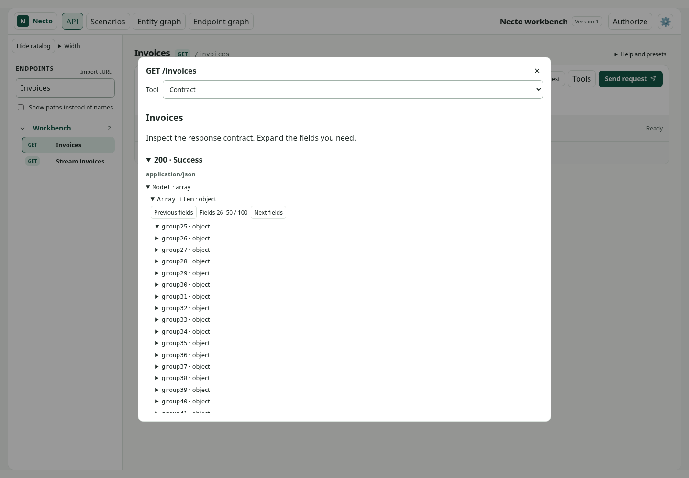

# F04 — Mount contract details only when requested

Closed model nodes now contain only their summaries. Opening a model mounts at most 25 children at a time, including composition variants. Raw OpenAPI serialization and example bodies are deferred until opened; closing Raw releases its text. Existing depth protection remains in place.

On the report's 5,000-field fixture, the default contract dropped from 20,313 DOM elements to 12, with no Raw pre element. Browser checks cover field pagination, nested expansion, lazy Raw and request-example → reviewed draft regression. Production build passes.

