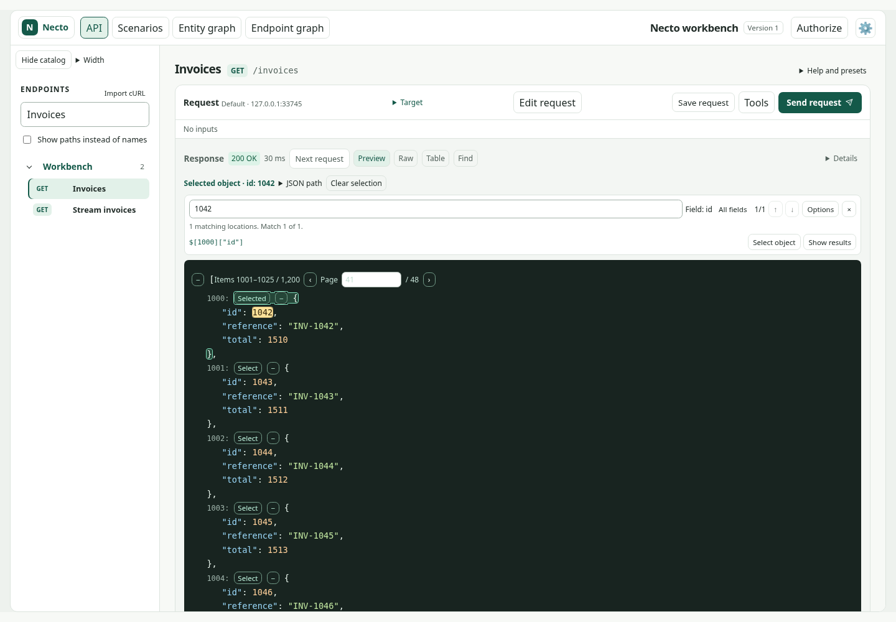

# F05 — Continue beyond the first 200 suggestions

An empty suggestion list now offers Search whole response. It closes/unpins Next request, focuses the existing Find and searches all response pages in the worker. When the source field is unambiguous, a visible field filter prevents matching an unrelated total instead of an invoice ID; All fields restores general search. The 200-suggestion render limit and typed literals remain supported.

Validation: production build, 14 search/mapping tests and a browser flow with 1,200 invoices. ID 1042 (row 1001) is found, selected, passed into the next draft and saved as binding [1000, "id"] rather than a frozen literal.

