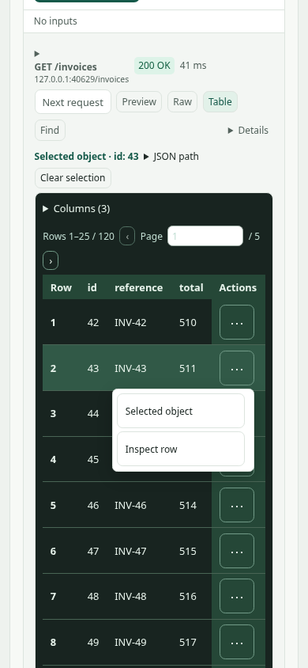

# F06 — Give mobile table width back to data

Mobile rows use one 44px action trigger instead of two fixed Select/Inspect buttons. A single contextual menu provides both actions with arrow-key navigation, Escape/focus restoration, outside-click dismissal and focus transfer into inspected JSON. Desktop buttons remain directly available.

At 390px, Actions drops from 136.3px (48.4% of the table) to 67.8px (24.1%). Browser checks cover Select, Inspect, preserved selection on return, keyboard recovery and no page overflow. Production build passes.

