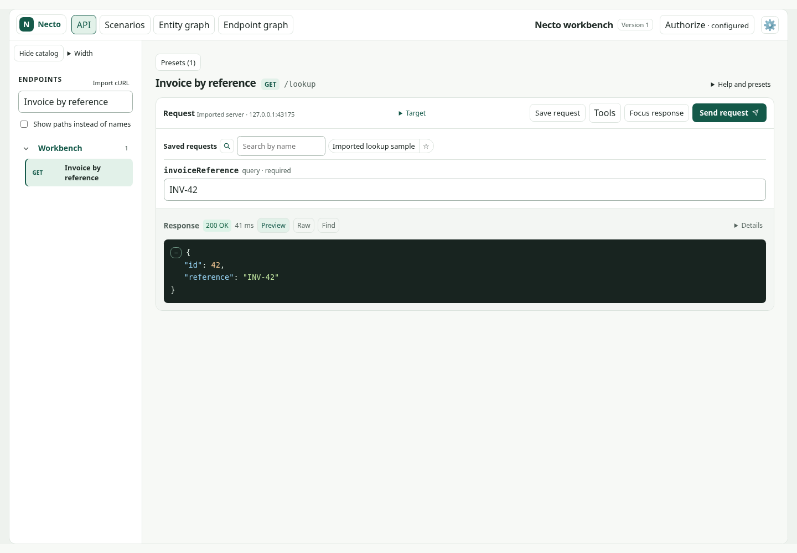

# F07 — Apply workspace imports without restarting the tab

After a successful storage transaction, only affected runtime stores refresh: scenarios, saved requests, presets, server profiles and external connections. Imported items become usable immediately. Existing request/response context and tab-memory credentials survive ordinary collection imports; replaced connection identities still use normal targeted invalidation and credential-origin rules. Multiple changed APIs are handled together. Import does not persist authentication or auto-apply imported samples to the current draft.

Validation: 150 UI/module tests, production build, selective-refresh/disposal and multi-connection tests. Browser imports scenario/sample/preset/server in one transaction, uses them without document reload, retains the response and authenticated requests, and confirms the token is absent from browser storage.

