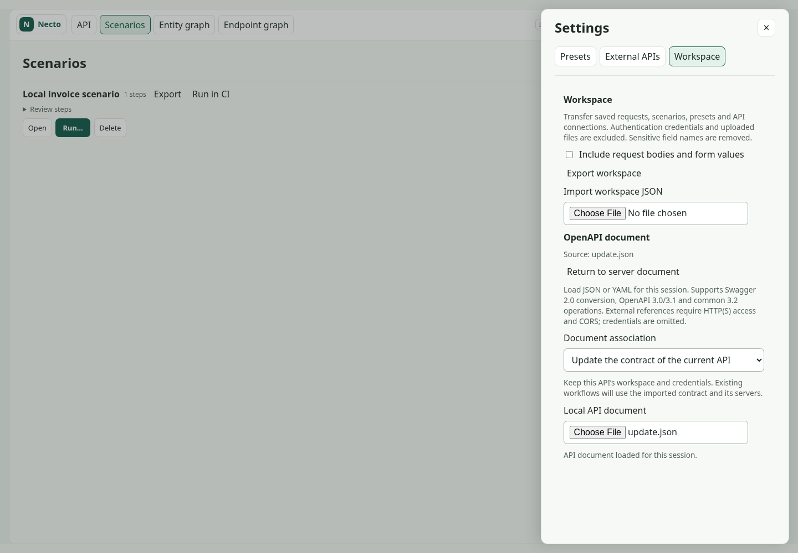
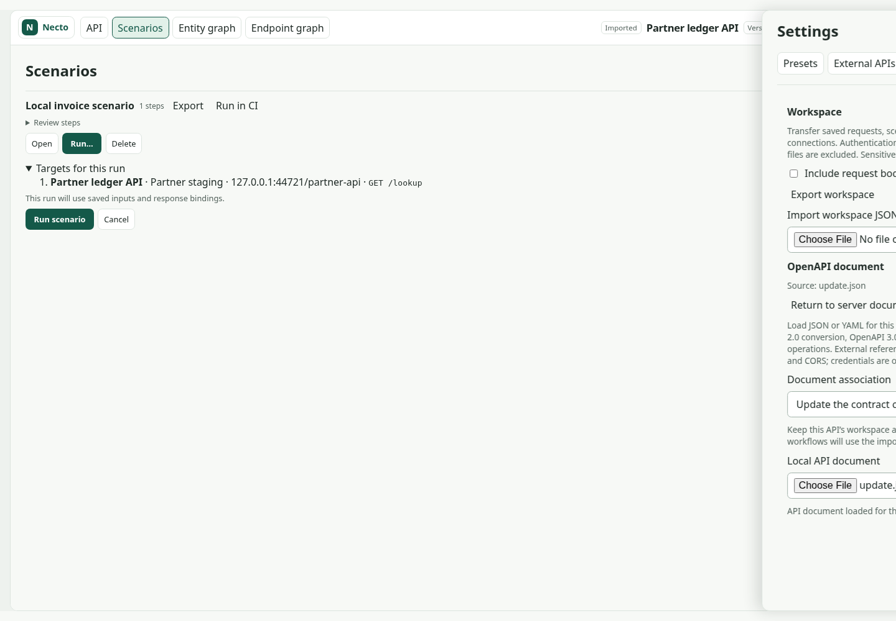

# G01 — API workspace identity

Importing a different API inherited drafts and scenarios matched only by method/path. Import now defaults to a separate named workspace, while updating the current contract is explicit. Reuse the workspace name when reopening the same API. Scenario preflight shows the current API and server; switching workspaces cannot repopulate history from a canceled old request.

Validation: focused regression tests, production UI build and synthetic review fixtures. The combined six-PR integration passed 176 module tests and the reviewed browser flows. No production API was called.

[Recorded observations](verification.json).
