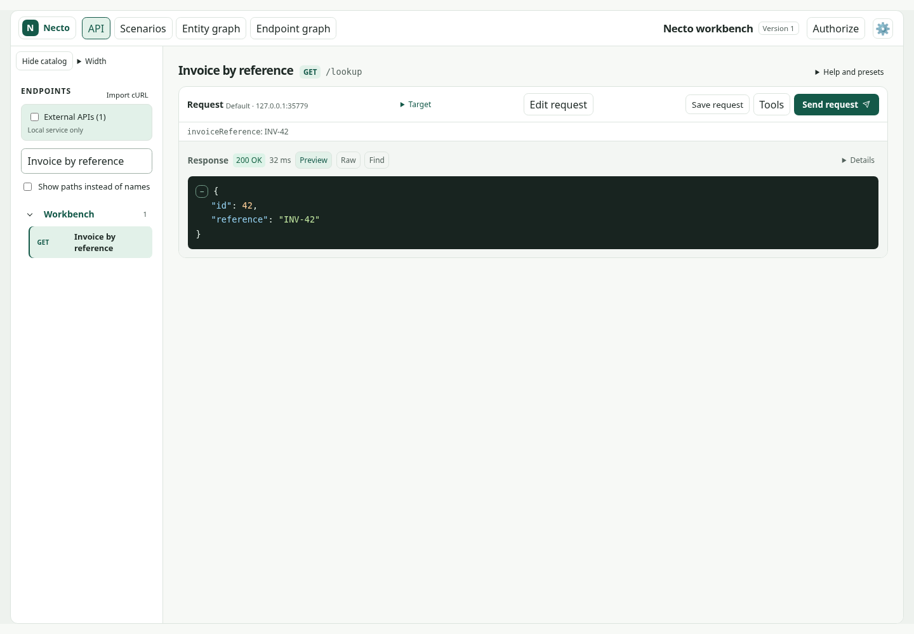

# G02 — Scoped authentication invalidation

Authorizing API B erased API A’s response and history. Bearer changes now invalidate only the affected API. Shared browser-cookie sessions invalidate the affected origin. Pending canceled requests cannot repopulate cleared results or history.

Validation: focused regression tests, production UI build and synthetic review fixtures. The combined six-PR integration passed 176 module tests and the reviewed browser flows. No production API was called.

[Recorded observations](verification.json).
