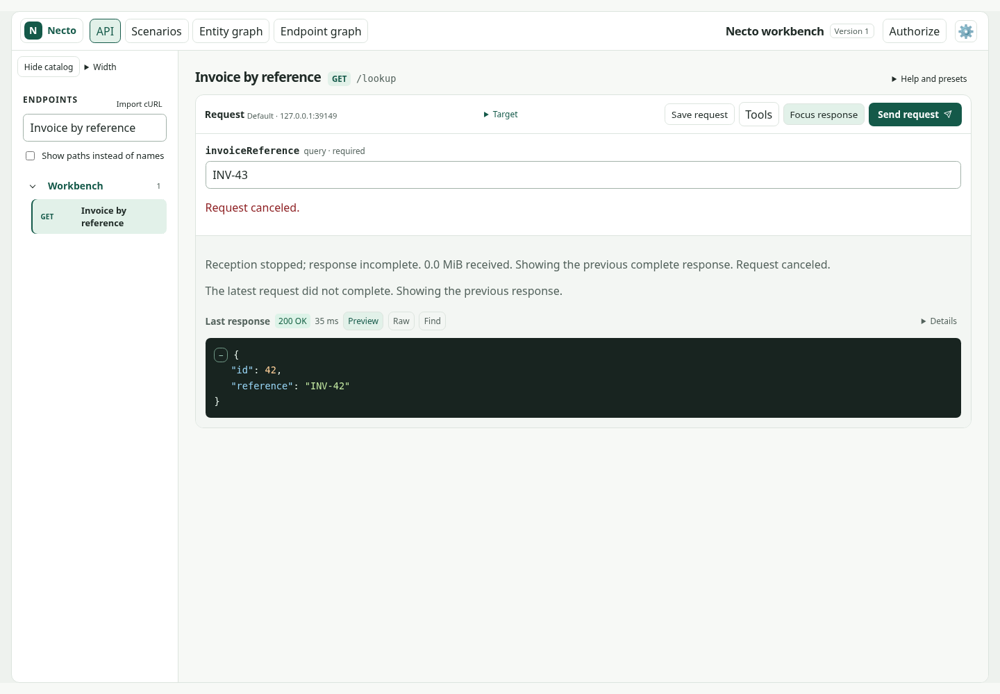

# G03 — Keep the last complete response

Starting reception replaced the last complete preview with an incomplete placeholder. One completed response is now kept while receiving the next normal response, including after Cancel, timeout and budget/network failures. Progress belongs to the retained result so clearing the result also clears its progress. Live stream behavior is unchanged.

Validation: focused regression tests, production UI build and synthetic review fixtures. The combined six-PR integration passed 176 module tests and the reviewed browser flows. No production API was called.

[Recorded observations](verification.json).
