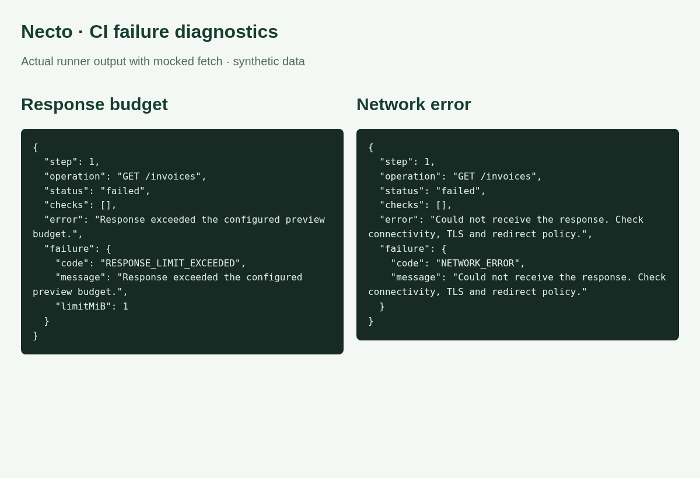

# G04 — Actionable CI diagnostics

Different failures used the same generic message. JSON and JUnit now include fixed safe reasons and stable codes, with numeric budget/timeout/HTTP context. Raw exception text and response values are omitted. The image renders actual runner output with mocked fetch; it is not an additional application screen.

Validation: focused regression tests, production UI build and synthetic review fixtures. The combined six-PR integration passed 176 module tests and the reviewed browser flows. No production API was called.

[Recorded observations](verification.json).
