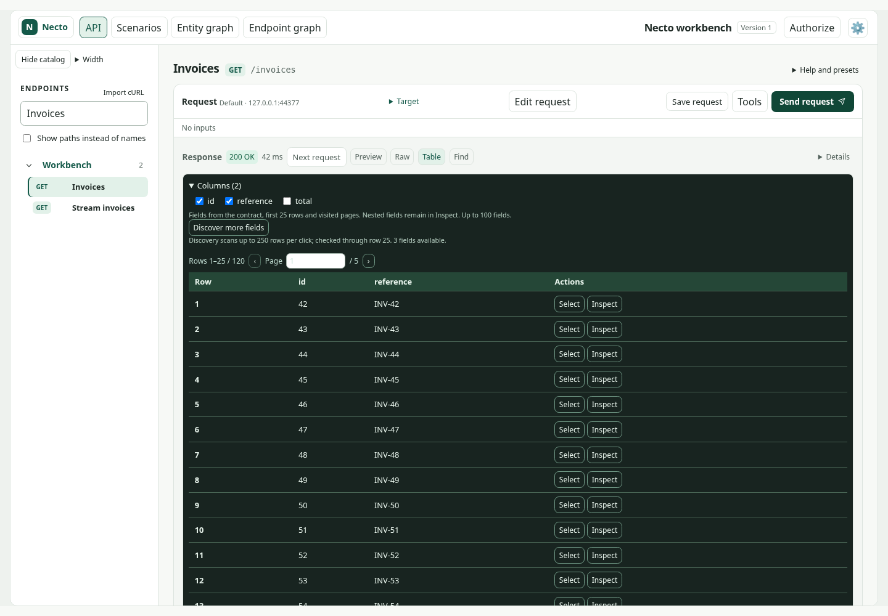

# G05 — Keep compatible table preferences

Resending reset Table and hidden columns. Request sessions now remember presentation by endpoint, collection path and bounded structural fingerprint. Old object selection resets; incompatible responses fall back to JSON. At most eight column configurations are retained without storing row values.

Validation: focused regression tests, production UI build and synthetic review fixtures. The combined six-PR integration passed 176 module tests and the reviewed browser flows. No production API was called.

[Recorded observations](verification.json).
