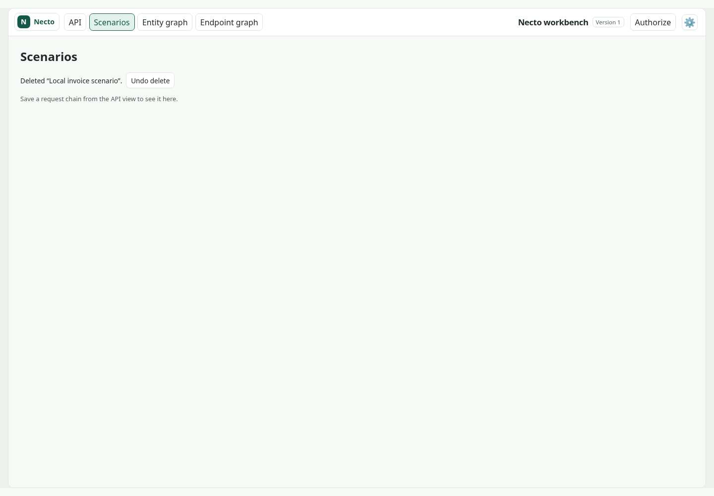
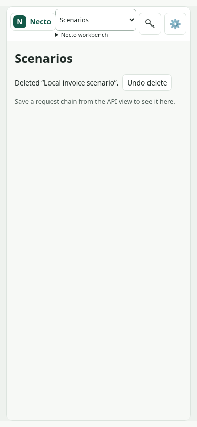

# G06 — Undo scenario deletion

Delete had no simple recovery path. Compact feedback offers Undo delete for 30 seconds, restoring the saved definition and list position without executing requests. Recovery is workspace-scoped, retryable after storage errors and does not overwrite conflicts.

Validation: focused regression tests, production UI build and synthetic review fixtures. The combined six-PR integration passed 176 module tests and the reviewed browser flows. No production API was called.

[Recorded observations](verification.json).
