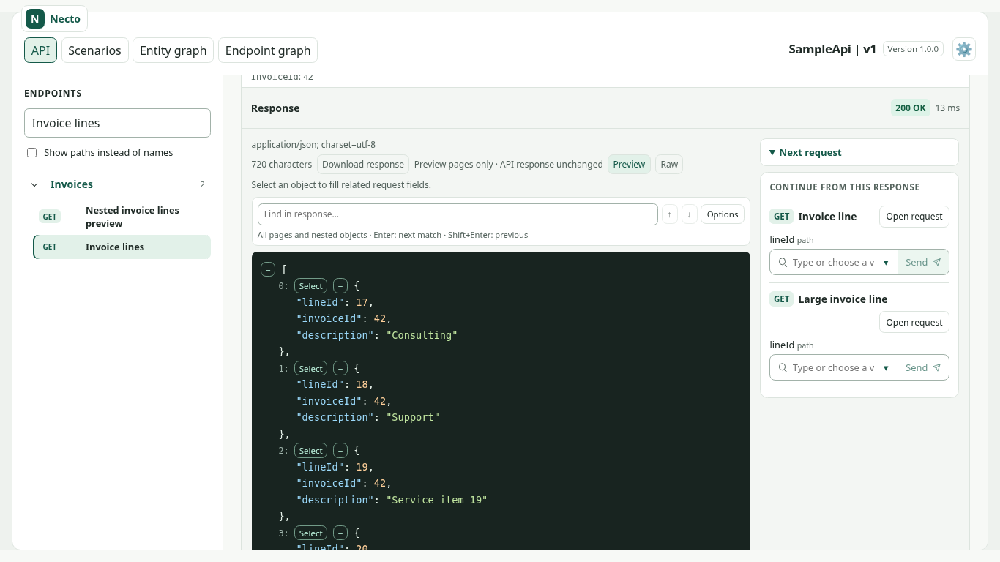
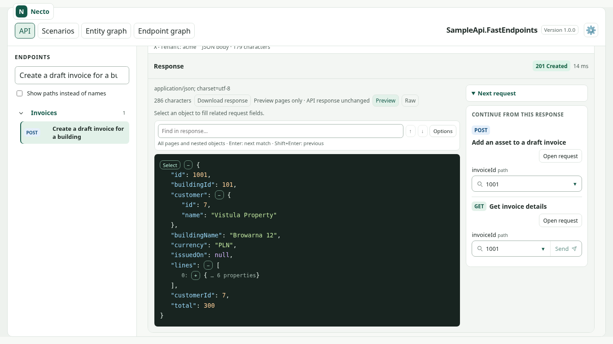

# R1: odpowiedź przed pełnym formularzem

Problem: formularz GET zajmował około 148 px, a przykładowy POST około 439 px także po otrzymaniu odpowiedzi.

Poprawka: udany GET/HEAD przechodzi do krótkiego podsumowania; „Edit request” przywraca formularz. POST ma świadomą akcję „Focus response”. Preferencja jest pamiętana w sesji karty. Podsumowanie zachowuje parametry, kontekst tenanta, źródła presetów i informację o body; wrażliwe nazwy pól są maskowane. Błąd przywraca formularz, a aktywna edycja nie jest automatycznie zwijana. Przewinięcie uwzględnia położenie danych odpowiedzi, a nie tylko nagłówka.

Weryfikacja: build UI; Chromium GET → edycja → ponowienie, nieprawidłowe pole wymagane, POST 201 z X-Tenant: acme, odtworzenie pól po rozwinięciu, szerokość 390 px, brak błędów JavaScript.

