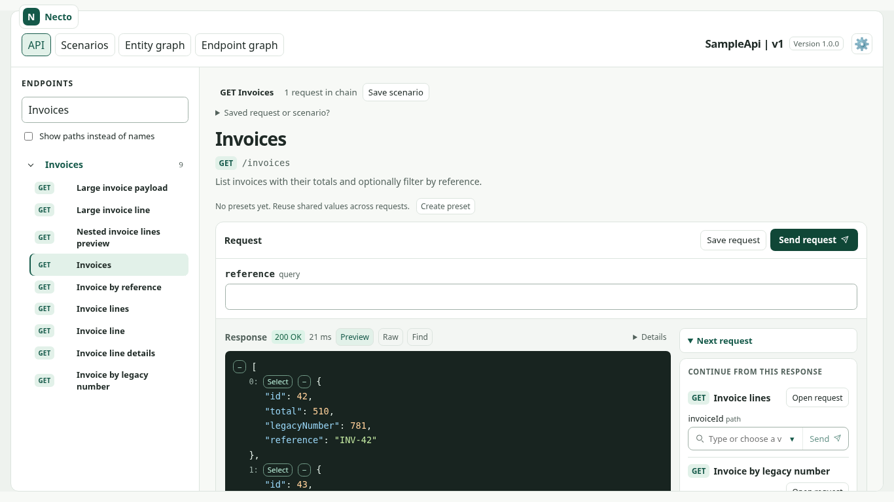
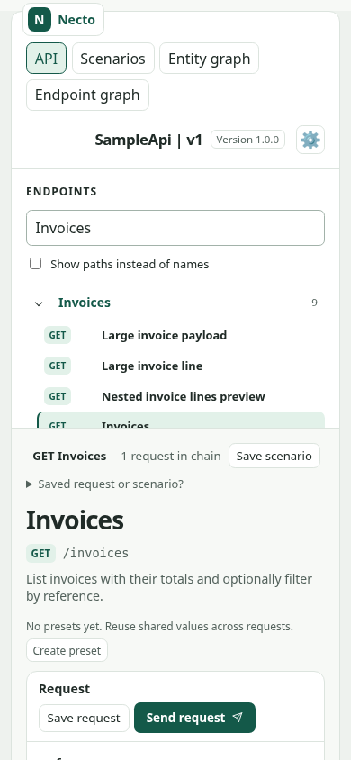

# R2: jeden pasek odpowiedzi

Problem: nagłówki, metadane, instrukcje i wyszukiwanie zabierały na telefonie około 297 px przed pierwszym JSON.

Poprawka: wspólny pasek Response / status / czas / Preview / Raw / Find / Details. Metadane i pobieranie znajdują się w Details, a wyszukiwanie otwiera się na żądanie. Zamknięcie zachowuje zapytanie i wyniki. Ctrl/⌘+F działa wewnątrz podglądu; Escape zamyka wyszukiwanie i przywraca fokus. Informacja o zaznaczonej encji pozostaje widoczna. Pusta wyszukiwarka nie wyświetla stałego wiersza instrukcji.

Weryfikacja: build UI; Chromium: Find i zachowanie zapytania, fokus i Escape, pobranie response.json, wyszukanie i zaznaczenie obiektu na ostatniej stronie 1000-elementowej odpowiedzi, szerokość 390 px; brak błędów JavaScript.

