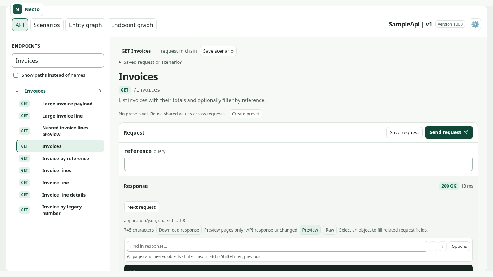
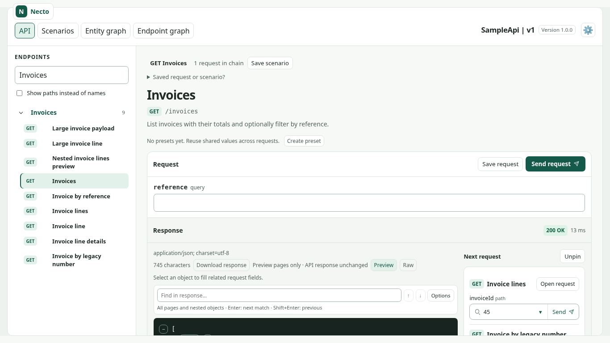

# R3: powiązane requesty na żądanie

Problem: boczna kolumna Next request stale odbierała JSON około 272 px szerokości.

Poprawka: domyślny przycisk otwiera modalny panel kontynuacji. Na szerokim ekranie można przypiąć go obok odpowiedzi i odpiąć. Jeden panel zachowuje wpisane wartości przy przenoszeniu, ma obsługę Escape/fokusu i zamyka się po przejściu do kolejnego endpointu. Na telefonie nie oferuje przypięcia. Usunięto podwójny nagłówek kontynuacji.

Weryfikacja: build UI; Chromium: wzrost szerokości JSON powyżej 900 px, otwarcie/przypięcie/odpięcie, zachowanie wpisanej wartości, zaznaczenie obiektu i wywołanie powiązanego requestu, automatyczne zamknięcie panelu, Escape i szerokość 390 px; brak błędów JavaScript.

