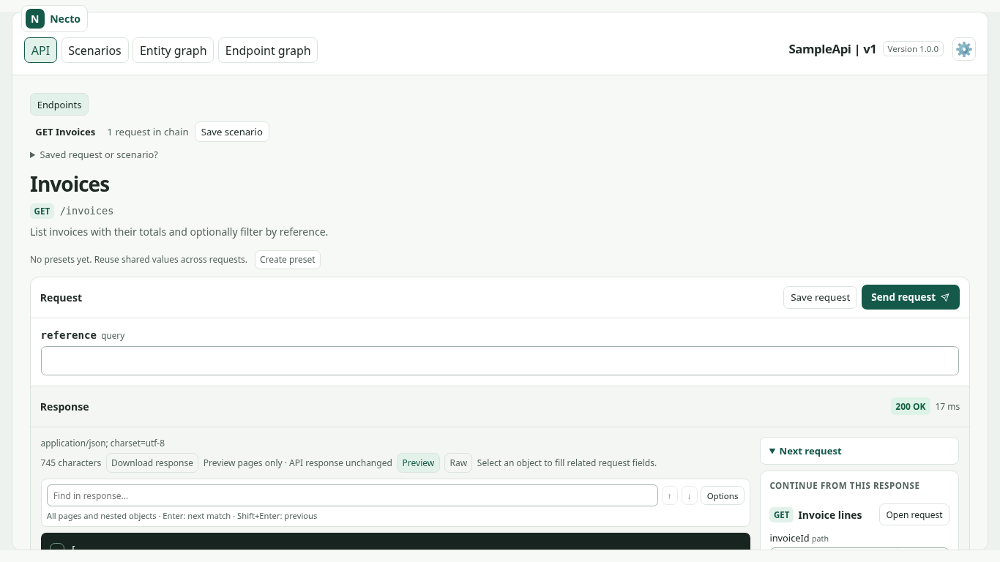
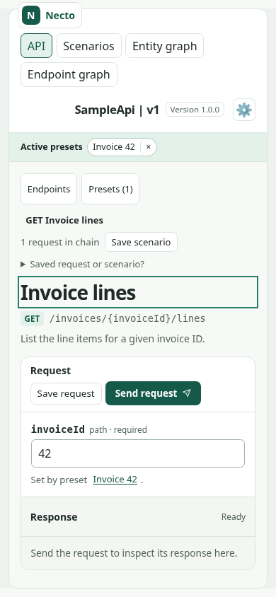

# R4: regulowany katalog i presety w panelu

Problem: katalog zabierał 288 px szerokości, presety kolejne 144 px, a na telefonie katalog zajmował znaczną część pierwszego ekranu.

Poprawka: katalog startuje od 240 px, ma regulację 180–360 px z zapamiętaniem szerokości oraz możliwość ukrycia i otwarcia. Na telefonie startuje zwinięty i chowa się po wyborze endpointu. Presety otwiera przycisk z licznikiem; aktywne wartości i źródła nadal są widoczne w głównym kontekście. Wyszukiwanie katalogu zachowuje stan po schowaniu.

Weryfikacja: build UI; Chromium: klawiaturowa zmiana szerokości i odświeżenie, ukrycie/otwarcie katalogu, odzyskanie szerokości JSON, aktywacja presetu i uzupełnienie pola, pasek aktywnych wartości, mobilny wybór endpointu, Escape w panelu presetów; brak błędów JavaScript.

