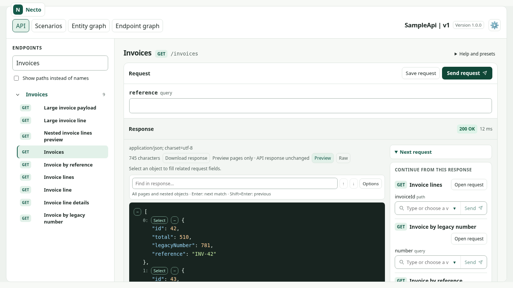

# R5: zwarty kontekst endpointu

Problem: nazwa operacji, breadcrumbs, opis, pomoc zapisu i wskazówka presetów zajmowały kilka osobnych wierszy przed formularzem.

Poprawka: mniejszy wspólny nagłówek endpointu z metodą i ścieżką. Opis, słownik zapisów i wskazówki presetów są pod Help and presets. Breadcrumbs i główny zapis scenariusza pojawiają się przy wielu krokach lub edycji scenariusza. Zapis jednego kroku pozostaje dostępny w pomocy. Aktywne presety i pochodzenie wartości nadal są widoczne w ich kontekście.

Weryfikacja: build UI; Chromium: krótsza droga do JSON, dostęp do opisu/pomocy i ustawień presetów, zapis jednoetapowego scenariusza, breadcrumbs i zapis wieloetapowego łańcucha, szerokość 390 px; brak błędów JavaScript.

