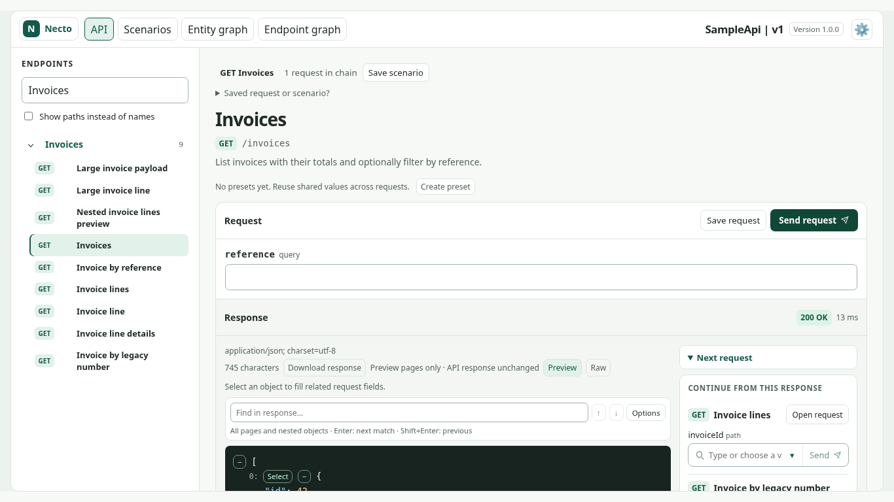
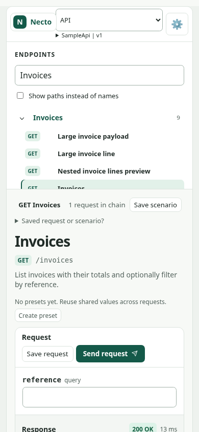

# R6: niższy nagłówek aplikacji

Problem: globalna nawigacja zabierała około 86 px na laptopie i 175 px na telefonie.

Poprawka: niższy wspólny pasek z logo, widokami, API i ustawieniami. Na telefonie widoki wybiera natywny selektor, nazwa API pozostaje widoczna, a pełna nazwa, wersja i opis są dostępne po jej rozwinięciu. Ustawienia i wybór widoku zachowują dotykowy rozmiar kontrolek.

Weryfikacja: build UI; Chromium: wysokość poniżej 70 px na laptopie i 90 px na telefonie, nawigacja między widokami, mobilny wybór wszystkich widoków, otwarcie/zamknięcie Settings i powrót fokusu, brak poziomego overflow i błędów JavaScript.

