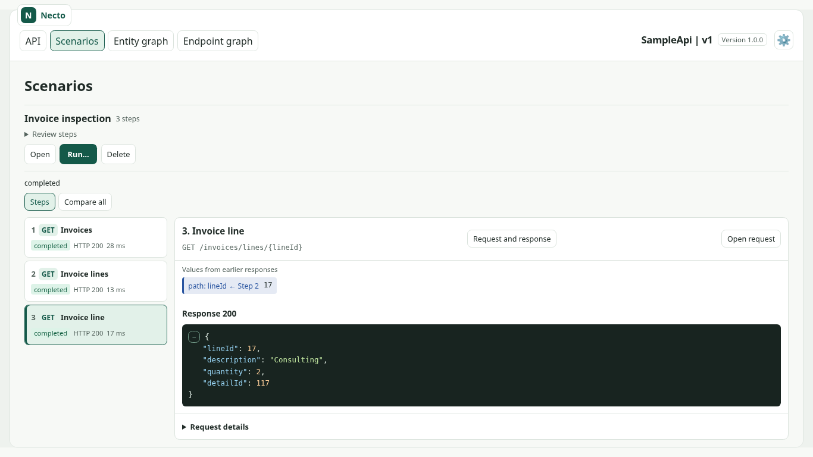
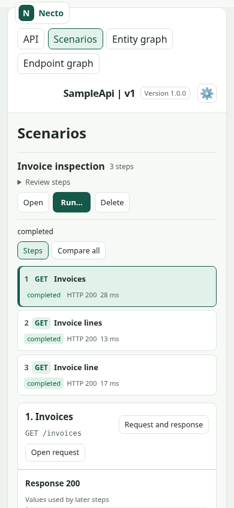

# R7: odpowiedź jako główny wynik scenariusza

Problem: szczegóły GET dzieliły przestrzeń po równo między krótki request i odpowiedź; na telefonie request był przed wynikiem.

Poprawka: odpowiedź domyślnie zajmuje pełną szerokość, request jest rozwijanym szczegółem. Wartości przeniesione z poprzednich kroków pozostają widoczne i pozwalają wrócić do źródła. Opcja Request and response pokazuje oba obszary w proporcji około 1:2. Na telefonie odpowiedź jest pierwsza również przy porównaniu. Compare all pozostaje dostępne.

Weryfikacja: build UI; Chromium: wykonanie trzyetapowego scenariusza, pełna szerokość odpowiedzi, widoczne źródło wartości, rozwijanie requestu i proporcje porównania, zmiana kroku, kolejność sekcji przy 390 px i Compare all; brak błędów JavaScript.

