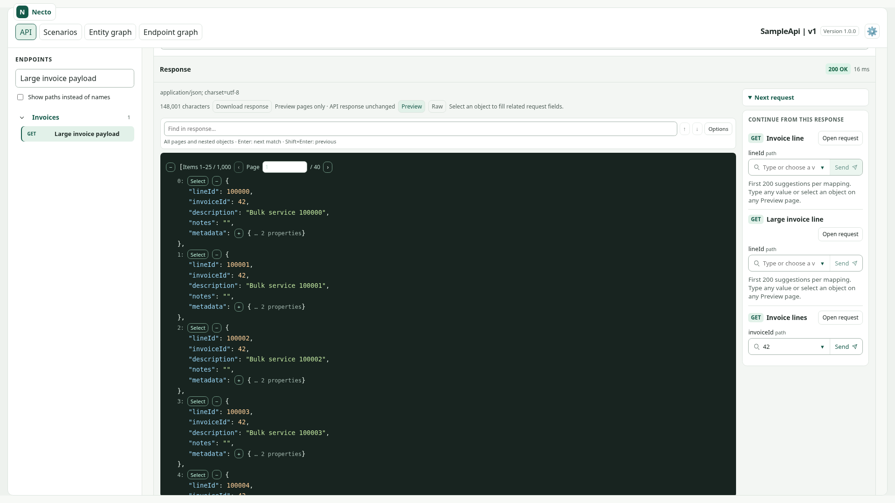
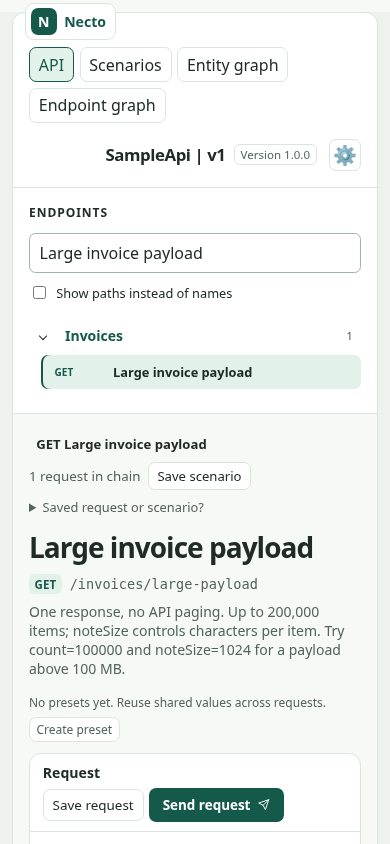

# R8: wysokość Preview wynikająca z panelu

Problem: Preview miało stały limit 32 rem (około 512 px), niezależny od miejsca dostępnego na ekranie.

Poprawka: dostępna wysokość wynika z panelu odpowiedzi, narzędzi i viewportu. Aktualizuje się przy zmianie okna, przewijaniu, Raw/Preview i zmianach układu; obsługuje też visualViewport. Krótkie odpowiedzi zachowują naturalną wysokość. Narzędzia podglądu pozostają pod ręką podczas przewijania. Paginacja i ograniczenie liczby renderowanych węzłów pozostają bez zmian.

Weryfikacja: 84 testy UI (4 nowe dla obliczania przestrzeni), build UI; Chromium: Preview wyższe niż 512 px na dużym ekranie, zmniejszenie okna, Raw/Preview, wyszukiwanie i zaznaczenie obiektu na ostatniej stronie 1000-elementowej odpowiedzi, szerokość 390 px; brak błędów JavaScript.

