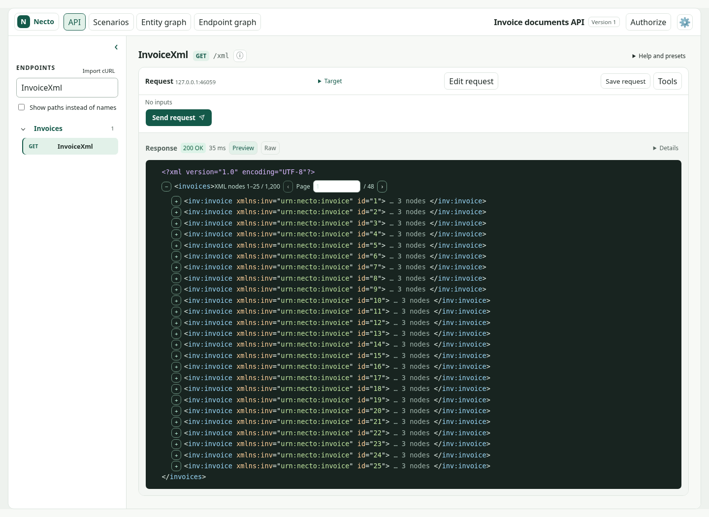
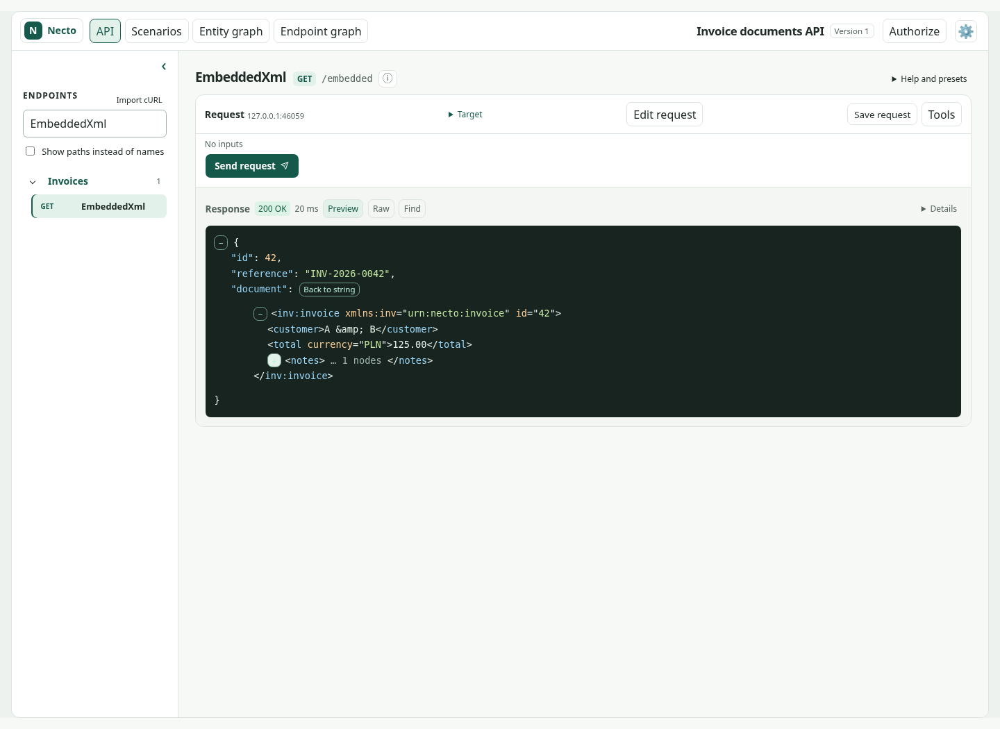

# XML response preview

Necto now previews both standalone XML responses and XML documents stored in JSON strings.

- **Standalone XML:** Preview/Raw in the existing response toolbar. Recognizes `application/xml`, `text/xml` and `+xml` media types, with a markup hint for plain-text or untyped responses.
- **Embedded XML:** an **XML preview** button beside a likely XML string. Parsing starts only when opened. **Back to string** restores the normal JSON representation.
- **Less scrolling:** short scalar elements appear inline; other elements expand on demand. Child nodes and attributes have pages of 25 entries. Long text and attribute values have pages of 2,000 characters.
- **No live markup:** namespaces, attributes, entities, comments, processing instructions and CDATA are displayed as text, never executed. DTD documents are rejected by Preview; Raw and download remain available.
- **Original data:** Preview does not replace the JSON string or response text. Existing JSON selections, mapped values and whole-response JSON search keep working. Search navigation returns an open XML field to its original string so the match is visible.





[Mobile preview](xml-in-json-mobile.png)

## Try it

Run SampleApi and open `/necto/`:

1. Send `InvoiceXmlPreview` (`GET /invoices/xml-preview?count=1200`) and navigate the local Preview pages. The API still returns one complete XML document.
2. Send `InvoiceXmlDocument` (`GET /invoices/42/xml-document`) and open **XML preview** beside `document`. The surrounding JSON object retains its mappings through its explicit `invoiceId` key.

## Performance and limits

XML parsing runs in a disposable Web Worker. Changing the response, closing an embedded preview, selecting Raw for a standalone response, or cancelling the XML preview terminates its worker. The resulting flat index avoids recursive serialization. Deep trees can be inspected as focused subtrees after 24 rendered levels.

Pagination limits rendered content; it does not reduce response download size. The existing request response budget still applies. XML Preview additionally caps its index at 200,000 nodes/attributes, 16 Mi characters of names/values, and 2,048 nesting levels. Exceeding a limit or receiving malformed XML shows an explicit message; Raw and download remain available. Formatting-only whitespace is omitted from element-only views, while mixed content and inherited `xml:space="preserve"` are retained. Raw retains the original response text.

This change does not add XPath mapping, XSD validation, whole-document XML search, or object selection within XML. Names longer than 200 characters are shortened in the tree; use Raw for the complete names. Existing JSON mappings can still transfer the entire XML string.

## Validation

The browser fixture covers a 1,200-invoice document, local pagination, Raw/download fidelity, opt-in embedded XML, JSON search, long values, attribute pagination, deep subtree navigation, mobile controls, invalid XML and DTD fallback. It also verifies that embedded markup creates no live image and issues no external request.

```sh
node --test Necto.UI/src/features/*/*.test.js
npm run build --prefix Necto.UI
node Necto.UI/tests/xml-preview.e2e.cjs
```

For local screenshots, set `NECTO_XML_SCREENSHOTS=docs/xml-preview` when running the browser fixture. The fixture uses the built `Necto.UI/dist` assets and a temporary local HTTP server.
